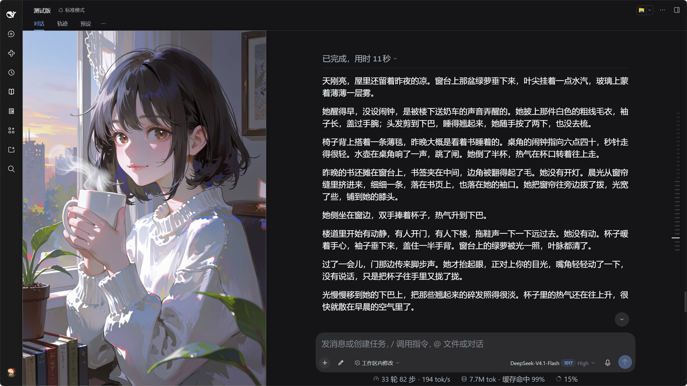
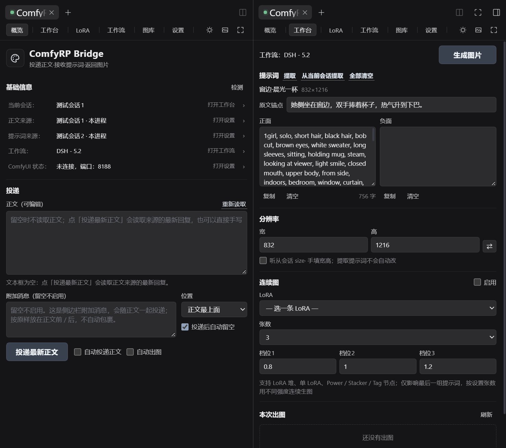
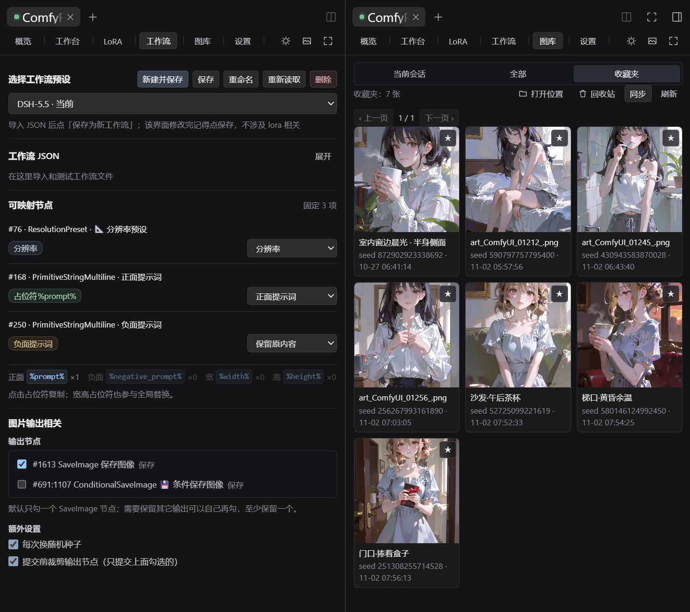

# ComfyRP Bridge

**装在 DSH 里的本地文生图自动化桥。**

```text
DSH 会话 → ComfyRP Bridge → 提示词会话 → 本地 ComfyUI → 图片回 DSH
```

自动把会话正文送去写成提示词，再调本机 ComfyUI 出图，最后把图片送回右侧栏、悬浮球和图库。聊天、出图、看图在同一个界面里完成。



## 安装

需要本地 ComfyUI，DSH 0.2.x。

```powershell
dsh plugin --profile web add dsh-comfyui-rp
```

装完重启 DSH。插件市场里也能装；还没发 npm 时用仓库地址：

```powershell
dsh plugin --profile web add git+https://github.com/bmhty123/dsh-comfyui-rp.git
```

改代码用本地目录装法：`node tools/install.mjs --apply`（卸载加 `--uninstall`）。

装好打开右侧栏，在「开始」里点 **ComfyRP**。

## 第一次使用

1. **设置 → ComfyUI**：填地址（默认 `http://127.0.0.1:8188`），点「测试连接」。
2. **工作流**：导入 ComfyUI 的 API JSON →「解析预览」→ 确认正面 / 负面 / 分辨率 / 输出节点 → 保存 → 启用。
3. **设置 → 正文来源 / 提示词来源**：默认跟随当前会话，也可以指定别的会话。
4. **概览**：打开「自动投递正文」，需要自动出图再打开「自动出图」。
5. 先手动试一次：填正文或附加消息，点「投递最新正文」。



## 能做什么

- **自动出图**：捕获正文 → 解析提示词 → 出图 → 归档，全自动；投递和出图可分开开关。
- **投递**：正文来源和提示词来源分开，可指到另一个会话甚至另一台 DSH；附加消息放正文最上面或最下面，投递成功后自动留空。
- **看图**：右侧栏面板、全屏、悬浮球、悬浮图片框。翻页、下载、收藏、刷新、删除、圆角；自己拖过 / 缩过之后，切图不再改回初始大小。
- **跟图**：滚动正文自动切图，连续图按段落比例拆位置，可切光标跟图、手动偏移、清空定位。
- **工作台**：三种提示词格式（内置 / 全部匹配 / 自定义标签）、多套正负面、标题、原文锚点、分辨率、连续图、LoRA、随机种子、干跑。
- **图库**：当前会话 / 全部 / 收藏夹 / 回收站，收藏是复制副本，删错了能还原。
- **工作流与 LoRA**：导入 ComfyUI API JSON，自动识别正面 / 负面 / 分辨率 / 输出节点，支持占位符和节点映射；LoRA 支持堆 / 单 / Power / Stacker / Tag，可改名、调强度、存回工作流。



## 常用操作

- **让下一轮自动出图**：概览打开「自动投递正文」+「自动出图」，保持右侧栏或悬浮球开着。
- **临时手动出一张**：悬浮球 → 铅笔菜单 →「请求生成」，读来源会话的最新正文。
- **只重做一张**：图片框 → 重新生成 →「仅此图」；整套重来选「全部」。
- **找图**：图库 → 当前会话 / 全部 / 收藏夹 / 回收站。
- **会话没更新**：概览右上「检测」，或设置里会话旁的「刷新」。
- **清理跟图定位**：图片框 → 更多 →「清空定位」，只清当前会话，之后按比例重新分配。

## 说明

- 图片按**当前聊天**归档；换正文来源不改变图片归属。
- 数据存在 DSH 数据目录下，设置里能看到和修改。
- 悬浮球和图片框限制在 DSH 窗口内；右侧栏默认收起，从会话标题栏展开。
- 远程会话要求两台 DSH 都装本插件。
- 提示词质量取决于你选的提示词会话，推荐搭配 [anima-tagger](https://github.com/Vincent54122/anima-tagger)（本插件不包含、不修改它）。

## 许可

**MIT License**，见 [LICENSE](LICENSE)。ComfyUI 节点识别思路参考了 [dsh-tavern-image](https://github.com/weixinlll/dsh-tavern-image)，完整声明见 [THIRD_PARTY_NOTICES.md](THIRD_PARTY_NOTICES.md)。
