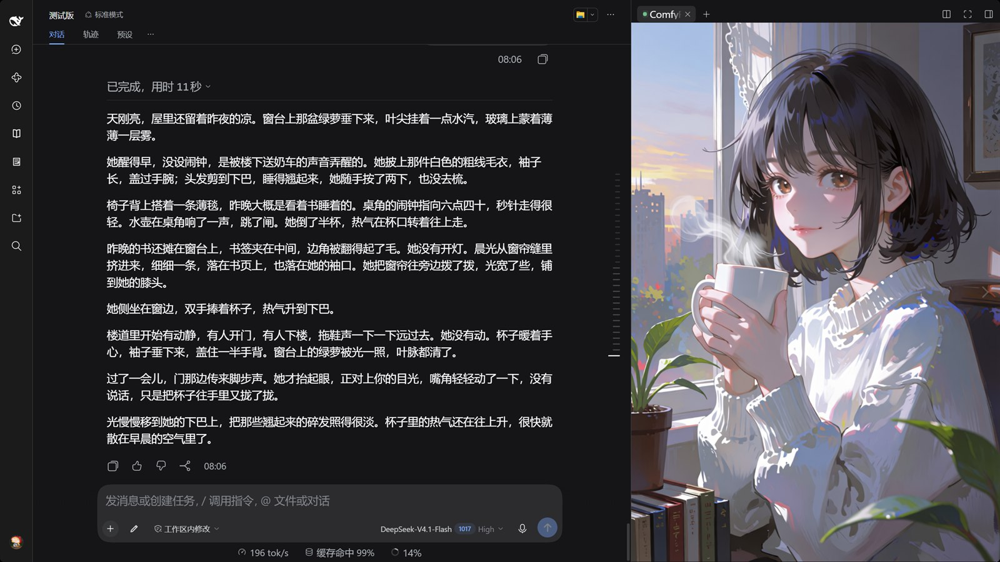
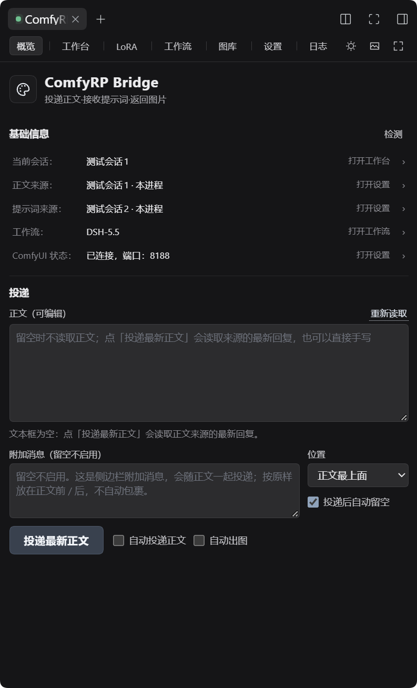
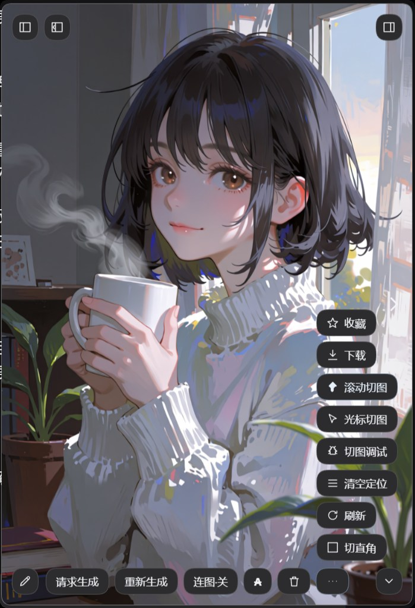
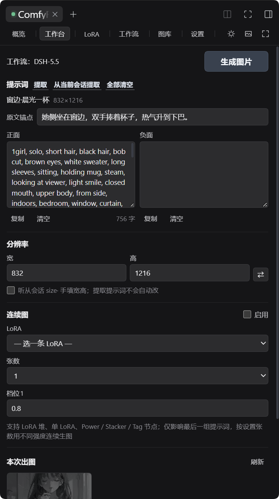
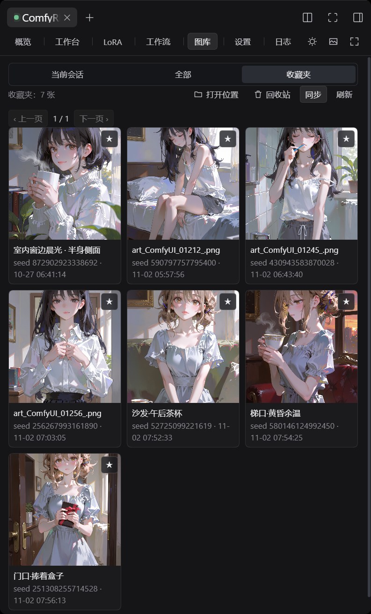
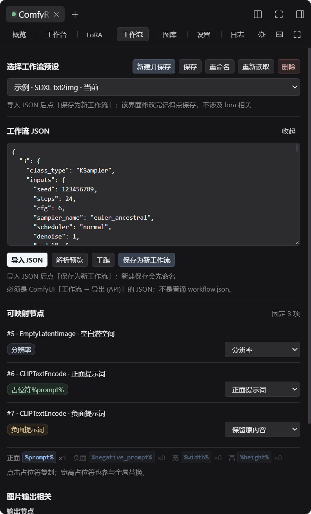

# ComfyRP Bridge

**装在 DSH 里的本地文生图自动化桥。**

ComfyRP Bridge 把 DSH 会话、提示词会话和本地 ComfyUI 串在一起：自动把正文送去写成提示词，再调用本地 ComfyUI 出图，最后把图片送回 DSH 右侧栏、悬浮球和图库。装好之后，聊天、出图、看图可以在同一个界面里完成。

> npm 包名 / 仓库名：**`dsh-comfyui-rp`**（界面里叫 ComfyRP，市场卡片按包名搜 `comfyui` 也能找到）。

```text
DSH 会话 → ComfyRP Bridge → 提示词会话 → 本地 ComfyUI → 图片回 DSH
```



## 能做什么

### 自动出图

- 自动捕获正文、投递、解析提示词、出图、归档。
- 「自动投递正文」「自动出图」可分别开关；悬浮球 **A** 是总开关。
- 手动投递最新正文、请求生成、重新生成（仅此图 / 本轮全部）。
- 请求生成会用同一正文的新图替换旧图，不误伤其它正文。
- 纯黑图自动补图；同一正文只保留最新一组，收藏过的旧图仍在收藏夹。
- 连续图（按段落比例拆滚动位置）；点「仅此图」会整组替换并保留各档强度。
- 随机种子、超时 / 中止 / 失败提示。



### 投递与来源

- 正文来源、提示词来源分开设置，默认跟随当前会话。
- 也可以指定本进程或另一台 DSH 的会话。
- 概览里的正文框默认留空，不会随加载 / 切换自动填入；点「投递最新正文」或打开「自动投递正文」时才读取，也可以直接手写。手写内容只在点「投递最新正文」时优先使用，其它投递仍读来源会话。
- 同一个会话既是正文来源又是提示词来源时，自动抓取会跳过它；工作台里直接手动出图不受影响。
- 附加消息可放在正文最上面或最下面，投递成功后自动留空。
- 远程会话只负责读写正文，出图仍然在本机 ComfyUI 完成。
- 正文里的 `@bubble:角色id|名字||[台词]` 会自动去掉 `@bubble:角色id`，保留 `|名字||[台词]` 再投递 / 匹配。

### 看图与跟图

- 右侧栏面板、全屏看图、悬浮球和图片框。
- 悬浮球 / 图片框可拖动、贴边、滚轮缩放，并记住位置、尺寸和圆角；自己缩放 / 拖过之后，切图不会再改回初始大小。
- 图片框可固定左侧、悬浮左侧或进入右侧栏全屏；停靠时会话自动让位，留空宽度可拖。「悬浮于左侧」只在进入时帮框放一次位，之后位置、尺寸和分隔线都只由用户调。
- 左右翻页、页码、下载、收藏、刷新、删除、圆角切换；删除当前图优先停到下一张。
- 右侧栏全屏和悬浮框的切图 / 调试状态同步；切到其它标签再回来，图片和页码保持不变。
- 滚动正文自动切图；连续图按段落比例拆位置，段落太短滚到底仍显示最后一张。
- 可选光标跟图。
- 跟图调试、手动偏移、清空当前会话的定位。
- 看过的图切回时不再重新加载；翻页前会先准备好下一张。



### 工作台与提示词

- 三种提示词方式：内置格式、全部匹配、自定义标签。
- 工作台可手填，也可从提示词来源或当前会话提取。
- 多套正负面、标题、原文锚点、分辨率。
- 连续图、LoRA、随机种子、输出节点裁剪、生图。
- 自动流程跑完自动回填；本地草稿不会被旧任务覆盖。
- 已删除的图片在「本次出图」里保留灰色占位。



### 图库

- 当前会话 / 全部 / 收藏夹 / 回收站。
- 每页 9 张、三列，分页在顶部。
- 打开位置、同步、刷新；收藏是复制副本，原图不动。
- 删除后卡片立即消失，大图查看器自动关闭；回收站可还原。



### 工作流与 LoRA

- 导入 ComfyUI 的 API JSON，保存、重命名、重新读取、删除。
- 解析预览、干跑、启用。
- 自动识别正面 / 负面 / 分辨率 / 输出节点，支持占位符和节点映射；负面默认保留原内容。
- LoRA 支持堆、单 LoRA、Power、Stacker、Tag；堆可折叠、排序，可调强度、开关、保存到工作流。
- 点 LoRA 名称可改显示名；点「保存到工作流」生效，「重置」恢复默认名。
- 连续图选中的那条 LoRA 会灰显：强度和开关由连续图接管，但仍可拖动排序。



### 界面

- 概览 / 工作台 / LoRA / 工作流 / 图库 / 设置 / 日志。
- 全屏看图：页码、左右翻页、悬浮窗同款菜单、滚轮调右侧栏宽度。
- 日间 / 夜间模式、窄栏布局、轻提示和出图完成提示。
- 图片框菜单每一项都是图标 + 名字。

## 安装

需要本地 ComfyUI，适用于 DSH 0.2.x（`engines.dsh` 已声明 `>=0.2.0 <0.3.0-0`）。

### 方式一：命令行（推荐）

```powershell
dsh plugin --profile web add dsh-comfyui-rp
```

装完重启 DSH。重启后 Host 半区日志里应出现 `[airp-comfy] 路由已注册：/__airp_comfy/*`。

### 方式二：插件市场

在 DSH 的插件市场里搜 `dsh-comfyui-rp` 安装。国内网络如果连不上 npm 官方源，可在市场的「自定义地址」里填镜像，例如 `https://mirrors.huaweicloud.com/repository/npm/`。

### 方式三：本地目录（改代码用）

把整个插件目录放到任意位置（不要拆开），在插件目录运行：

```powershell
node tools/install.mjs --apply
```

它会在 profile 里建一个指向本目录的目录联接，之后改 `lib/*` 刷新页面就能看到效果。卸载用 `node tools/install.mjs --uninstall`。

装好后打开右侧栏，在「开始」里点 **ComfyRP**。

## 第一次使用

1. **设置 → ComfyUI**：填地址（默认 `http://127.0.0.1:8188`），点「测试连接」。
2. **工作流**：导入 ComfyUI 的 API JSON →「解析预览」→ 检查正面 / 负面 / 分辨率 / 输出节点 → 保存 → 启用。
3. **设置 → 正文来源**：默认勾选「本会话」；要固定来源时取消勾选，再选会话。
4. **设置 → 提示词来源**：选一个会写提示词的会话，点「测试」。
5. **设置 → 提示词格式**：选择内置 / 全部匹配 / 自定义。
6. **概览**：确认「自动投递正文」；需要自动出图再打开「自动出图」。
7. 想先手动试一次，就填好正文或附加消息，点「投递最新正文」。

## 常用操作

- **让下一轮自动出图**：概览打开「自动投递正文」和「自动出图」，保持右侧栏或悬浮球可用。
- **临时手动出图**：悬浮球 → 铅笔菜单 →「请求生成」，读正文来源的最新正文。
- **只重做一张**：图片框 → 重新生成 →「仅此图」；整套重来选「全部」。
- **换正文来源**：设置 → 正文来源；要固定会话就取消「本会话」。
- **会话名不对 / 列表没更新**：点概览右上「检测」，或设置里会话旁的「刷新」；都会重新读取未归档会话和会话名。
- **让图片跟着正文滚动**：打开「滚动切图」；想用鼠标位置临时切图，再开「光标切图」。
- **清理跟图定位**：图片框 → 更多 →「清空定位」，只清当前会话的图片，之后按比例分配。
- **找图**：图库 → 当前会话 / 全部 / 收藏夹 / 回收站。
- **改工作流**：工作流页导入 JSON，确认映射后保存、启用。
- **调 LoRA**：LoRA 页拖动排序或改强度，保存到工作流。

## 说明

- 图片按**当前聊天**归档，换正文来源不会改变图片归属。
- 数据保存在 DSH 数据目录下，可在设置里查看和修改。
- 悬浮球和图片框限制在 DSH 窗口内，不能拖出窗口。
- 右侧栏默认收起，需要从会话标题栏展开，再点「开始」里的 ComfyRP。
- 远程会话要求两台 DSH 都装本插件。
- 浏览器跨站写请求会被拒绝。
- 日间模式只改右侧栏；悬浮球和大图查看器保持深色。
- 提示词格式里的「？」有内置格式说明和示例。

## 推荐搭配

提示词质量取决于你选择的提示词会话。推荐搭配 **Vincent54122** 的 [anima-tagger](https://github.com/Vincent54122/anima-tagger)，它擅长把文字需求整理成规范的 Danbooru 标签 + 英文描述。

本插件不包含、不修改、不调用 anima-tagger，只在文档中推荐。

## 许可

本项目采用 **MIT License**，见 [LICENSE](LICENSE)。

ComfyUI 节点识别部分在思路上参考了 MIT 许可的 [dsh-tavern-image](https://github.com/weixinlll/dsh-tavern-image)；完整声明见 [THIRD_PARTY_NOTICES.md](THIRD_PARTY_NOTICES.md)。
